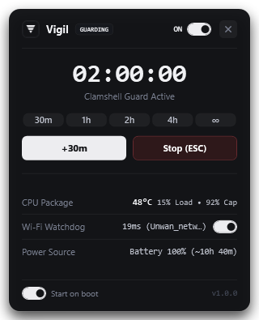
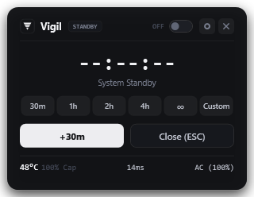
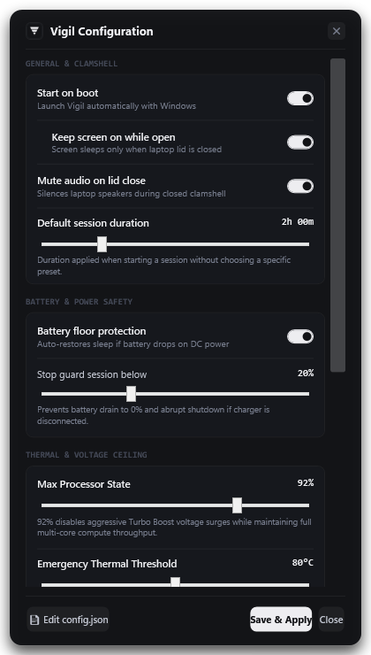

<p align="center">
  
</p>

<h1 align="center">Vigil</h1>

<p align="center">
  <strong>Keep your Windows laptop awake. Cap thermals. Give the session an end time.</strong>
</p>

<p align="center">
  A minimalist Windows menu bar popover and CLI for timed clamshell sessions, thermal throttling, and background workload protection. Built with an industrial interface inspired by Insomnia macOS, Dieter Rams, and Teenage Engineering. Vigil lives quietly in your taskbar notification area, keeping your laptop awake with the lid closed while preventing CPU thermal runaway during overnight AI agent runs, 3D rendering, or compilation jobs.
</p>

<p align="center">
  <a href="#quick-start"><strong>Quick Start</strong></a> ·
  <a href="#what-you-can-use-it-for"><strong>Use Cases</strong></a> ·
  <a href="#features"><strong>Features</strong></a> ·
  <a href="#how-to-cancel"><strong>How to Cancel</strong></a> ·
  <a href="#configuration"><strong>Configuration</strong></a> ·
  <a href="#cli-and-automation"><strong>CLI & Automation</strong></a>
</p>

<p align="center">
  <a href="LICENSE"></a>
  
  
  <a href="https://github.com/davinmaritza/vigil/releases/latest"></a>
</p>

<p align="center">
  &nbsp;&nbsp;&nbsp;&nbsp;
  
</p>

> **Important**: Always operate your laptop on a stable, well-ventilated desk surface, never inside a closed backpack or soft bed. Vigil keeps the CPU awake and throttles voltage, but hardware still requires ambient airflow.

---

## What you can use it for

Vigil is engineered for headless compute tasks where you need to close your laptop lid, leave it on your desk, and prevent Windows from sleeping or thermal throttling:

- **AI Agents & Model Inference**: Run Antigravity, Claude Code, Cursor, Ollama, LM Studio, ComfyUI, vLLM, or PyTorch pipelines overnight.
- **3D Rendering & Simulation**: Leave Blender, Unreal Engine, Maya, or Cinema 4D renders churning without keeping the laptop open.
- **Video Encoding & Exports**: Complete DaVinci Resolve, Adobe Premiere Pro, or Handbrake encodes in peace.
- **Codebase Compilation**: Build large Rust, C++, .NET, or Android projects without accidental sleep interruptions.
- **Batch Processing & Ingestion**: Complete large multi-gigabyte cloud transfers and data ingestion jobs reliably.

---

## How to cancel

Vigil provides four immediate, fail-safe ways to cancel an active guard session:

1. **Press `ESC` on your keyboard**: With the Vigil window open, pressing `ESC` instantly terminates the session and restores default Windows power policies.
2. **Prominent Stop Button**: The right-side action button lights up in high-contrast vermillion: **`Stop (ESC)`**.
3. **Master Hardware Switch**: Toggle the top-right switch in the flyout header to `OFF`.
4. **Right-Click System Tray**: Right-clicking the taskbar notification icon presents **`🛑 Stop Protection [Restore Normal]`** in bold at the top of the menu.
5. **Open the Laptop Lid**: Opening the physical laptop lid automatically restores the internal display panel backlight.

---

## Features

- **Compact Menu Bar Interface**: Ultra-sleek 268 × 208 px popover inspired by Insomnia on macOS, Dieter Rams, and Teenage Engineering. Floats right above your taskbar system tray with an Obsidian (`#131417`) and Moon-White (`#EDEDF0`) palette. 100% clean English typography with zero AI-slop.
- **Master Hardware Switch**: Direct `ON` / `OFF` toggle in the top-right header for instant manual protection without configuring a timer.
- **Quick Preset Chips**: Jump into `30m`, `1h`, `2h`, `4h`, or indefinite (`∞`) protection with a single click.
- **Safe Display Handling**: Display blackout on session start is disabled by default (`turnDisplayOffOnSession = false`), ensuring your screen never goes unexpectedly black while you work. When the physical laptop lid is closed, the display backlight sleeps naturally and wakes instantly on lid open.
- **CPU Thermal Throttler**: Enforces a 92% maximum processor state cap (`PROCTHROTTLEMAX`), preventing Intel and AMD Turbo Boost voltage spikes while preserving over 95% multi-core throughput. Core temperatures drop by 20°C to 25°C.
- **Wi-Fi Watchdog**: Periodically monitors local gateway ping latency and auto-reassociates dropped wireless profiles via `netsh` during headless operation, with an inline toggle switch in the flyout.
- **Background App Freezer**: Optionally suspends resource-hungry background applications (`slack.exe`, `discord.exe`, `spotify.exe`) via native `NtSuspendProcess` and resumes them when the session ends.
- **Write-Ahead Recovery Journal**: All modified power settings are logged atomically to `%LOCALAPPDATA%\Vigil\recovery.json` alongside an out-of-process Task Scheduler watchdog to guarantee 100% restoration even across sudden power loss or reboots.

---

## Quick start

### Prebuilt release (recommended)

1. Download `Vigil.exe` or `vigil-v1.0.2-win-x64.zip` from [GitHub Releases](https://github.com/davinmaritza/vigil/releases/latest).
2. Run `Vigil.exe`. The popover appears near your system tray.

```powershell
# Quick launch via PowerShell
Start-Process "Vigil.exe"
```

### Build from source

Requires the .NET 11 SDK:

```powershell
# Clone the repository
git clone https://github.com/davinmaritza/vigil.git
cd vigil

# Run test suite
dotnet test tests/Vigil.Tests/Vigil.Tests.csproj

# Publish standalone executable
dotnet publish src/Vigil/Vigil.csproj -c Release -r win-x64 --self-contained true -p:PublishSingleFile=true -p:IncludeAllContentForSelfExtract=true -o dist
```

---

## Configuration

Vigil includes an intuitive, visual Settings window—no manual editing of JSON files required.

<p align="center">
  
</p>

### How to access settings
- Click the **Gear icon `⚙`** in the top-right header of the Vigil popover.
- Or right-click the Vigil system tray icon and select **`⚙ Settings...`**.
- Or click **`📄 Edit config.json`** directly inside the Settings dialog to open your configuration file in Notepad.

### Configurable options

| Setting | Default | Description |
|:---|:---:|:---|
| **Start on boot** | `Off` | Automatically launches Vigil on Windows startup via HKCU Run registry. |
| **Keep screen on while open** | `On` | Keeps the laptop display awake while you work; screen sleeps only when physical lid is shut. |
| **Mute audio on lid close** | `On` | Automatically mutes laptop internal speakers when clamshell lid is closed. |
| **Max Processor State** | `92%` | Caps CPU voltage to prevent aggressive Turbo Boost heat surges while keeping 100% compute threads active. |
| **Emergency Thermal Cap** | `80°C` | Enforces an aggressive 80% throttle floor if CPU core package exceeds this temperature threshold. |
| **Wi-Fi ping watchdog** | `On` | Monitors gateway ping latency and auto-reconnects dropped Wi-Fi profiles via native `netsh`. |
| **Suspend heavy chat apps** | `On` | Pauses background apps (`Slack`, `Discord`, `Spotify`, `WhatsApp`) via `NtSuspendProcess` during runs. |
| **Auto-pilot supervisor** | `On` | Automatically arms clamshell guard when AI or compute tasks start (`Blender`, `Ollama`, `Python`, etc.). |

Settings are automatically persisted to `%LOCALAPPDATA%\Vigil\config.json`.

---

## What happens when the lid closes

Closing a laptop lid on Windows normally triggers Modern Standby, suspending background user processes and disconnecting network sessions.

If you manually set lid action to "Do nothing" in Windows Control Panel, modern processors boost to maximum aggressive turbo frequencies. In a closed chassis where exhausts are restricted by the hinge, CPU temperatures can rapidly climb past 90°C, causing severe throttling or emergency thermal shutdown.

Vigil resolves this:
1. **Prevents Sleep**: Keeps user compute processes and active terminals running uninhibited via `SetThreadExecutionState`.
2. **Suppresses Thermal Surges**: The 92% CPU ceiling disables Turbo Boost voltage spikes, reducing core temperatures by 20°C to 25°C while maintaining full multi-threaded throughput.
3. **Maintains Wireless Connectivity**: Automatically reassociates dropped Wi-Fi profiles if Windows disables the radio during headless operation.

---

## Recovery architecture

Vigil uses a two-tier write-ahead crash journaling design:

1. Before modifying power settings, Vigil snapshots your active power scheme GUID, original lid actions, and maximum processor states.
2. The snapshot is written atomically to `%LOCALAPPDATA%\Vigil\recovery.json`.
3. A scheduled task backstop is registered in Windows Task Scheduler set to run at `sessionEnd + 1 minute`.
4. Only after the journal is committed does Vigil apply power modifications and suspend background apps.

When a session ends normally, original settings are restored, suspended processes are thawed, the journal is cleared, and the watchdog task is cancelled.

If power is lost or Windows crashes, Vigil detects the orphaned journal on next boot (or via the Task Scheduler watchdog) and executes `Vigil.exe --recover` to restore system settings automatically.

---

## CLI and automation

Vigil includes a full command-line interface for terminal scripting, dev containers, and AI agent automation:

```powershell
# Show command-line help
Vigil.exe --help

# Query current telemetry as JSON
Vigil.exe --session status --json

# Start a session for 7200 seconds (2 hours)
Vigil.exe --session start 7200

# Extend active session by 1800 seconds (30 minutes)
Vigil.exe --session extend 1800

# End active session and restore power settings
Vigil.exe --session end

# Recover settings from disk journal after a crash
Vigil.exe --recover
```

### JSON telemetry output

Calling `Vigil.exe --session status --json` returns structured telemetry:

```json
{
  "status": "Active",
  "remaining_seconds": 5420,
  "target_process": "python.exe",
  "cpu_temp_celsius": 58,
  "cpu_max_state": 92,
  "wifi_ssid": "Studio-5GHz"
}
```

---

## Acknowledgements

- Inspired by [Insomnia](https://github.com/krishhgg/Insomnia) by [krishhgg](https://github.com/krishhgg) for the core concept of laptop clamshell awake utilities.

---

## License

[MIT](LICENSE)
